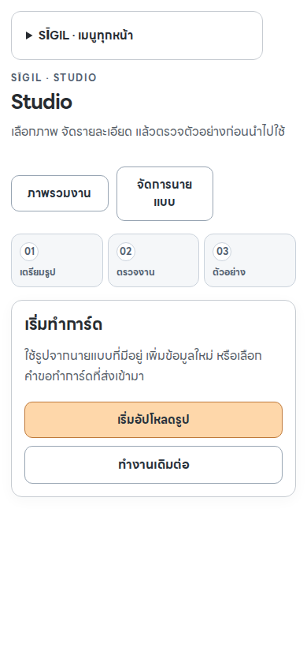
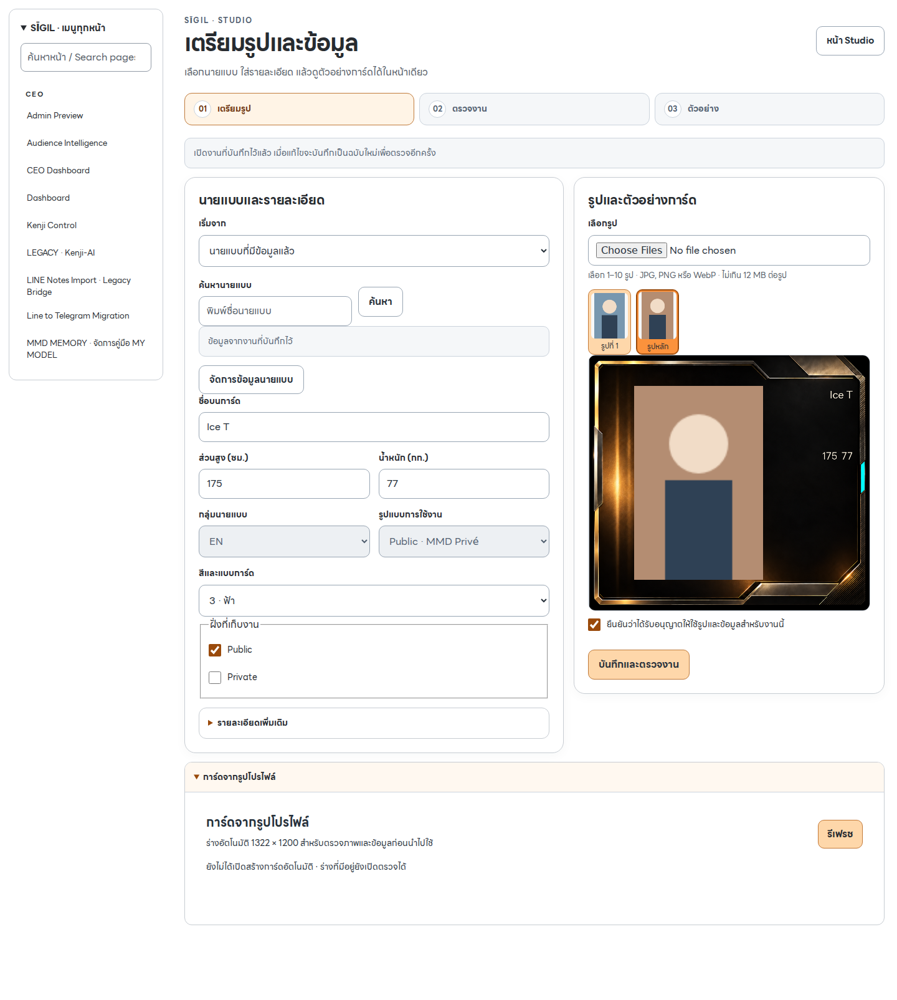
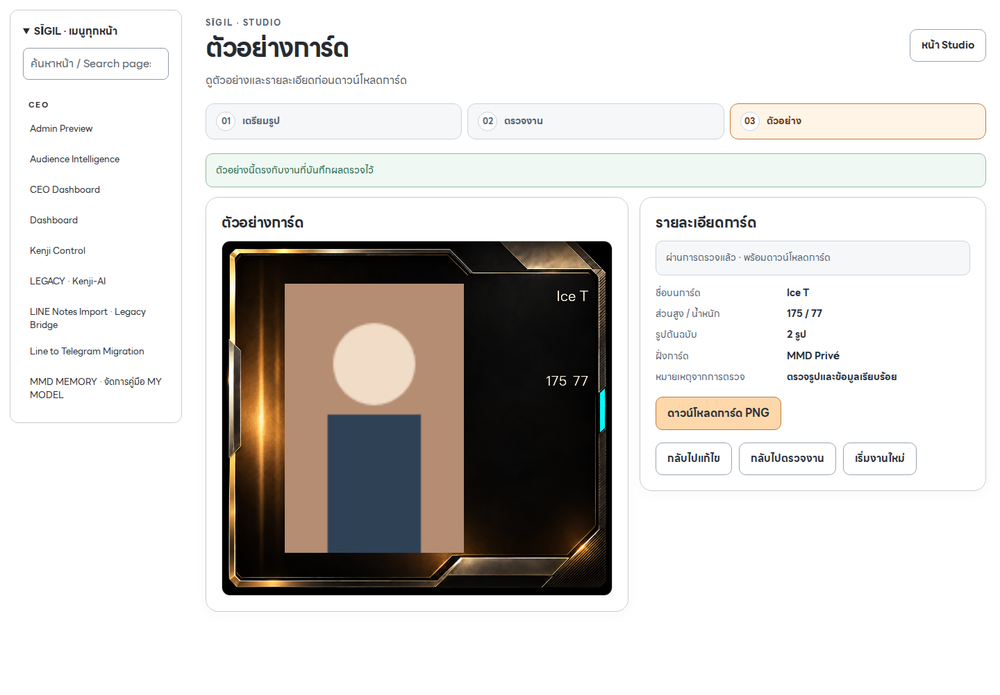

# Studio flow v2 — review package

## Scope and current status

The owner selected the complete Studio flow: the existing home, Upload, Review and Final Preview pages. The request is a bright, readable interface, clear Thai, one ordered flow and fewer unnecessary controls.

The four Webflow pages are staged and read back against the generated package. The backend changes are proposed on a GitHub branch. Neither main nor the production Worker has been changed by this work. No Webflow publication, paid generation, model publication, message sending or production data write was used for verification.

| Stage | Existing Webflow page |
| --- | --- |
| Home | `6a6e22f9f96d8a3a8fd56969` |
| Upload | `6a1be738a8018a51046e5335` |
| Review | `6a189ff7358e501d524bcce8` |
| Final Preview | `6a137a1836f0137aa0e08da9` |

## User-visible behavior

- White/silver panels, dark Thai text and soft orange primary actions. LINE Seed Thai regular and bold are loaded from the site's existing approved font assets.
- One primary path: prepare photos and data, save and review, confirm and open the finished card. Future steps stay unavailable until a server receipt exists.
- Select an existing model by name, record a new-model draft, or import a My Card request. Existing identity, measurements, field, world and assigned RUN come from canonical Models data.
- Preserve 1–10 originals, explicit main-photo selection, both audience choices, consent, and optional category/gender/client-type/note/Drive reference/proposed-album metadata. A new or incomplete model can remain a draft; approval requires complete canonical identity.
- Secondary details and the existing automatic-card inbox are collapsible. Automatic generation remains controlled by its existing server flag.
- Review uses three explicit checks and one decision. Final Preview rehydrates the approved immutable snapshot and checks current eligibility again before a PNG download.
- Changing source or model clears the previous source association and photos. Replacing a My Card photo clears its request association and consent. An edited intake is a new version requiring another review.
- Interrupted commits retain safe receipt references; retries resolve the existing result. Failed saves cannot navigate forward, and a later definitive rejection restores editable controls.

## Why the controller was replaced

The Webflow Upload draft called `/studio/api/intake/draft/*` and `/studio/api/model-context`, while Review and Final Preview still read legacy localStorage seeds. The deployed `admin-worker` bundle and main source had none of the draft routes. Read-only Cloudflare inspection confirmed both apex and www `/studio/api/*` routes point to that Worker. The old canvas also had an empty frame base.

V2 uses the deployed `/upload`, `/intake/validate`, `/intake/commit`, `/review/validate` and `/review/commit` contracts with an explicit `flow_version:2`. It adds authenticated reads and canonical model lookup, instead of bridging newer-looking controls into stale browser state. Drive is an optional stored reference; this release does not claim an unimplemented Drive backup or canonical-model sync. Proposed promotion albums are metadata, not publication actions.

## Backend and privacy boundaries

All new routes retain the signed admin session and strict same-origin gate. Browser storage contains only record identifiers and pending idempotency references. Source photos and blob URLs remain in page memory.

- `/intake/read` and `/review/read` accept a record ID or an idempotency reference for interrupted-response recovery.
- `/assets/read` resolves a fixed private R2 prefix and checks upload source, ID, size, MIME and checksum before streaming with private no-store headers. Object keys never leave the server.
- V2 commits persist normalized allowlisted fields. Review identity, assets and presentation are taken from its saved intake, not a browser-supplied replacement snapshot.
- Approval and approved reads recheck canonical model identity, policy, renderer completeness, current assets and any My Card association.
- AI-only identities cannot approve a real uploaded portrait through this manual flow. The existing automatic-card inbox remains separate.
- Same-payload serial retries reuse their existing receipt; changed payloads with the same key conflict. Airtable lookup/create is not an atomic uniqueness constraint across concurrent requests. Do not claim cross-tab concurrent exactly-once behavior.

The v1 API behavior, publication boundary and automatic-generation flags are unchanged.

## Artwork and fonts

Manual cards use the seven owner-approved clean-v1 PNGs already in the repository, pinned to `e25f3dcdcccc48b29111a483fd3ab4ce2c26cd64`. The browser fetches only that public artwork with credentials omitted, checks its exact SHA-256 and dimensions, then combines it locally with authenticated image blobs. The first pinned asset was verified HTTP 200 with matching SHA-256 and CORS enabled. All seven local asset hashes are tested.

This manual composition is **1316 × 1195**. The separately gated automatic renderer remains **1322 × 1200**. General accent choices 1–5 do not change classification; exclusive frames retain their assigned RUN without padding or truncation. Canonical names, including spaces, suffixes and Thai, remain intact. Preview and export share one canvas. Thai font readiness is checked before measuring or painting text.

## Verification

- 83 backend tests: 26 new v2 cases and 57 existing Studio/upload cases.
- 5 canonical context tests; 12 canvas/asset/font tests; 20 shared-theme tests.
- 4 integrated Chromium tests against the exact built Webflow package, with all HTTP intercepted and synthetic photos/records. The test uses the actual intake normalizer and canonical projection.
- All four stages at 360, 390, 768 and 1440 px: no horizontal overflow, measured text contrast at least 4.5:1, targets at least 44 px, visible keyboard focus and usable enabled step links. Expanded automatic-card tools are included.
- Actual 1316 × 1195 PNG download, server approval recheck before export, a Thai-name canvas export, missing-record guards, excess-photo rejection, failed writes, source replacement, explicit-link precedence and interrupted retry recovery.
- Existing LINE Seed font URLs verified HTTP 200 and CORS `*` for both production origins. Browser screenshots load the actual regular/bold WOFF2 bytes; mock fixtures do not contact production.
- Four primary embeds plus head/footer blocks read back byte-for-byte from Webflow. The 24 obsolete embeds are inert comments; eight legacy script elements have a non-executable MIME type; the two native legacy page sections are hidden reversibly.

Review images below are local fixture renders with synthetic photos, not authenticated production evidence.







Reproduce the package:

```sh
node scripts/build-studio-flow-v2.mjs /tmp/studio-flow-v2-package
```

Run the browser suite with an installed Playwright module/Chromium and optional cached site fonts:

```sh
PLAYWRIGHT_MODULE_PATH=/path/to/playwright \
CHROMIUM_EXECUTABLE=/path/to/chrome-headless-shell \
STUDIO_FONT_DIR=/path/to/regular-and-bold-woff2 \
STUDIO_SCREENSHOTS=/tmp/studio-flow-v2-qa \
node --test webflow/internal/admin/studio/studio-flow-v2.browser.test.mjs
```

`STUDIO_FONT_DIR` contains `regular.woff2` and `bold.woff2` from the two exact URLs in the builder. Without it, the fixture blocks font requests and does not certify Thai glyph rendering. In this workspace's Node 24 runner, add `--test-isolation=none` for detailed subtest reporting.

## Release sequence and rollback

The new frontend requires the new backend reads. After owner release authorization, merge through the repository's normal checks and verify the deployed Worker revision first. Then publish only the intended Studio changes using the site's supported publication mechanism. A whole-site publish can include other authors' pending edits: inspect the pending scope before using it. Verify a real authenticated manual intake/review/export on the deployed host, including refresh and mobile font loading, before marking production accepted.

Do not enable automatic card generation or model publication as part of this release. Do not send a real model request or mutate a production record merely to test it without selecting an appropriate owner-approved example.

The exact previous Webflow code and script attributes are in `flow-v2-webflow-before-20261025.json`. Restore each saved embed and head/footer block, restore the script attribute lists, and make native home element `a5792641-57f2-d47f-1993-7b7ffcd532b9` and Upload element `f375ddfe-0f79-1c85-ff11-b8422e329a00` visible again. Draft restoration does not itself publish. Backend rollback can retain the additive read routes while restoring the previous frontend, or revert this isolated commit through the normal deployment path.
